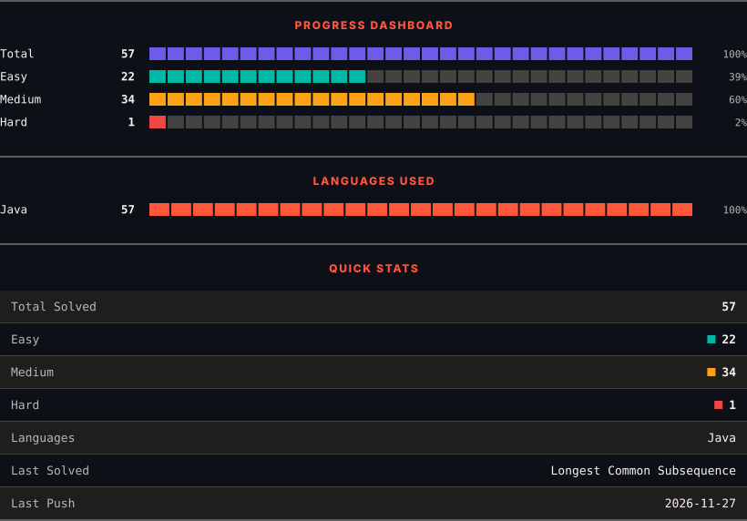
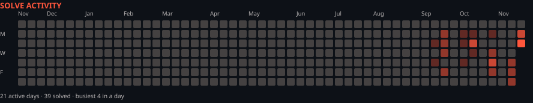

<h1>LeetCode Solutions</h1>

<em>Automatically synced with every accepted submission</em>

   

<picture>
  <source media="(prefers-color-scheme: dark)" srcset=".leetsync/stats-dark.svg">
  <source media="(prefers-color-scheme: light)" srcset=".leetsync/stats-light.svg">
  
</picture>

<picture>
  <source media="(prefers-color-scheme: dark)" srcset=".leetsync/calendar-dark.svg">
  <source media="(prefers-color-scheme: light)" srcset=".leetsync/calendar-light.svg">
  
</picture>

---

### ALL SOLUTIONS

**Latest 10**

| # | Problem | Difficulty | Language | Date |
|:---:|:--------|:----------:|:--------:|:----:|
| 700 | [Search in a Binary Search Tree](problems/0700-Search-in-a-Binary-Search-Tree) | 🟩 Easy | `Java` | 2026-11-19 |
| 236 | [Lowest Common Ancestor of a Binary Tree](problems/0236-Lowest-Common-Ancestor-of-a-Binary-Tree) | 🟧 Medium | `Java` | 2026-11-18 |
| 113 | [Path Sum II](problems/0113-Path-Sum-II) | 🟧 Medium | `Java` | 2026-11-18 |
| 714 | [Best Time to Buy and Sell Stock with Transaction Fee](problems/0714-Best-Time-to-Buy-and-Sell-Stock-with-Transaction-Fee) | 🟧 Medium | `Java` | 2026-11-17 |
| 680 | [Valid Palindrome II](problems/0680-Valid-Palindrome-II) | 🟩 Easy | `Java` | 2026-11-17 |
| 678 | [Valid Parenthesis String](problems/0678-Valid-Parenthesis-String) | 🟧 Medium | `Java` | 2026-11-17 |
| 605 | [Can Place Flowers](problems/0605-Can-Place-Flowers) | 🟩 Easy | `Java` | 2026-11-17 |
| 409 | [Longest Palindrome](problems/0409-Longest-Palindrome) | 🟩 Easy | `Java` | 2026-11-17 |
| 316 | [Remove Duplicate Letters](problems/0316-Remove-Duplicate-Letters) | 🟧 Medium | `Java` | 2026-11-17 |
| 204 | [Count Primes](problems/0204-Count-Primes) | 🟧 Medium | `Java` | 2026-11-17 |

<strong>🟩 Easy</strong> — 17 solved

| # | Problem | Difficulty | Language | Date |
|:---:|:--------|:----------:|:--------:|:----:|
| 70 | [Climbing Stairs](problems/0070-Climbing-Stairs) | 🟩 Easy | `Java` | 2026-10-29 |
| 94 | [Binary Tree Inorder Traversal](problems/0094-Binary-Tree-Inorder-Traversal) | 🟩 Easy | `Java` | 2026-11-12 |
| 100 | [Same Tree](problems/0100-Same-Tree) | 🟩 Easy | `Java` | 2026-11-14 |
| 110 | [Balanced Binary Tree](problems/0110-Balanced-Binary-Tree) | 🟩 Easy | `Java` | 2026-11-14 |
| 112 | [Path Sum](problems/0112-Path-Sum) | 🟩 Easy | `Java` | 2026-11-17 |
| 125 | [Valid Palindrome](problems/0125-Valid-Palindrome) | 🟩 Easy | `Java` | 2026-10-29 |
| 144 | [Binary Tree Preorder Traversal](problems/0144-Binary-Tree-Preorder-Traversal) | 🟩 Easy | `Java` | 2026-11-12 |
| 226 | [Invert Binary Tree](problems/0226-Invert-Binary-Tree) | 🟩 Easy | `Java` | 2026-11-16 |
| 257 | [Binary Tree Paths](problems/0257-Binary-Tree-Paths) | 🟩 Easy | `Java` | 2026-11-16 |
| 283 | [Move Zeroes](problems/0283-Move-Zeroes) | 🟩 Easy | `Java` | 2026-10-30 |
| 326 | [Power of Three](problems/0326-Power-of-Three) | 🟩 Easy | `Java` | 2026-09-25 |
| 409 | [Longest Palindrome](problems/0409-Longest-Palindrome) | 🟩 Easy | `Java` | 2026-11-17 |
| 509 | [Fibonacci Number](problems/0509-Fibonacci-Number) | 🟩 Easy | `Java` | 2026-10-08 |
| 605 | [Can Place Flowers](problems/0605-Can-Place-Flowers) | 🟩 Easy | `Java` | 2026-11-17 |
| 680 | [Valid Palindrome II](problems/0680-Valid-Palindrome-II) | 🟩 Easy | `Java` | 2026-11-17 |
| 700 | [Search in a Binary Search Tree](problems/0700-Search-in-a-Binary-Search-Tree) | 🟩 Easy | `Java` | 2026-11-19 |
| 860 | [Lemonade Change](problems/0860-Lemonade-Change) | 🟩 Easy | `Java` | 2026-09-17 |

<strong>🟧 Medium</strong> — 29 solved

| # | Problem | Difficulty | Language | Date |
|:---:|:--------|:----------:|:--------:|:----:|
| 22 | [Generate Parentheses](problems/0022-Generate-Parentheses) | 🟧 Medium | `Java` | 2026-09-25 |
| 31 | [Next Permutation](problems/0031-Next-Permutation) | 🟧 Medium | `Java` | 2026-09-23 |
| 39 | [Combination Sum](problems/0039-Combination-Sum) | 🟧 Medium | `Java` | 2026-09-21 |
| 40 | [Combination Sum II](problems/0040-Combination-Sum-II) | 🟧 Medium | `Java` | 2026-09-21 |
| 46 | [Permutations](problems/0046-Permutations) | 🟧 Medium | `Java` | 2026-09-22 |
| 49 | [Group Anagrams](problems/0049-Group-Anagrams) | 🟧 Medium | `Java` | 2026-10-30 |
| 62 | [Unique Paths](problems/0062-Unique-Paths) | 🟧 Medium | `Java` | 2026-10-13 |
| 63 | [Unique Paths II](problems/0063-Unique-Paths-II) | 🟧 Medium | `Java` | 2026-10-13 |
| 64 | [Minimum Path Sum](problems/0064-Minimum-Path-Sum) | 🟧 Medium | `Java` | 2026-10-14 |
| 102 | [Binary Tree Level Order Traversal](problems/0102-Binary-Tree-Level-Order-Traversal) | 🟧 Medium | `Java` | 2026-11-13 |
| 103 | [Binary Tree Zigzag Level Order Traversal](problems/0103-Binary-Tree-Zigzag-Level-Order-Traversal) | 🟧 Medium | `Java` | 2026-11-13 |
| 113 | [Path Sum II](problems/0113-Path-Sum-II) | 🟧 Medium | `Java` | 2026-11-18 |
| 122 | [Best Time to Buy and Sell Stock II](problems/0122-Best-Time-to-Buy-and-Sell-Stock-II) | 🟧 Medium | `Java` | 2026-09-15 |
| 131 | [Palindrome Partitioning](problems/0131-Palindrome-Partitioning) | 🟧 Medium | `Java` | 2026-10-05 |
| 179 | [Largest Number](problems/0179-Largest-Number) | 🟧 Medium | `Java` | 2026-11-17 |
| 189 | [Rotate Array](problems/0189-Rotate-Array) | 🟧 Medium | `Java` | 2026-10-29 |
| 198 | [House Robber](problems/0198-House-Robber) | 🟧 Medium | `Java` | 2026-10-12 |
| 199 | [Binary Tree Right Side View](problems/0199-Binary-Tree-Right-Side-View) | 🟧 Medium | `Java` | 2026-11-16 |
| 204 | [Count Primes](problems/0204-Count-Primes) | 🟧 Medium | `Java` | 2026-11-17 |
| 213 | [House Robber II](problems/0213-House-Robber-II) | 🟧 Medium | `Java` | 2026-10-13 |
| 216 | [Combination Sum III](problems/0216-Combination-Sum-III) | 🟧 Medium | `Java` | 2026-09-22 |
| 236 | [Lowest Common Ancestor of a Binary Tree](problems/0236-Lowest-Common-Ancestor-of-a-Binary-Tree) | 🟧 Medium | `Java` | 2026-11-18 |
| 316 | [Remove Duplicate Letters](problems/0316-Remove-Duplicate-Letters) | 🟧 Medium | `Java` | 2026-11-17 |
| 322 | [Coin Change](problems/0322-Coin-Change) | 🟧 Medium | `Java` | 2026-10-28 |
| 491 | [Non-decreasing Subsequences](problems/0491-Non-decreasing-Subsequences) | 🟧 Medium | `Java` | 2026-09-23 |
| 518 | [Coin Change II](problems/0518-Coin-Change-II) | 🟧 Medium | `Java` | 2026-10-28 |
| 678 | [Valid Parenthesis String](problems/0678-Valid-Parenthesis-String) | 🟧 Medium | `Java` | 2026-11-17 |
| 714 | [Best Time to Buy and Sell Stock with Transaction Fee](problems/0714-Best-Time-to-Buy-and-Sell-Stock-with-Transaction-Fee) | 🟧 Medium | `Java` | 2026-11-17 |
| 1143 | [Longest Common Subsequence](problems/1143-Longest-Common-Subsequence) | 🟧 Medium | `Java` | 2026-10-26 |

<strong>🟥 Hard</strong> — 1 solved

| # | Problem | Difficulty | Language | Date |
|:---:|:--------|:----------:|:--------:|:----:|
| 51 | [N-Queens](problems/0051-N-Queens) | 🟥 Hard | `Java` | 2026-10-06 |

---

Auto-synced by <strong>LeetSync</strong> · Built by <a href="https://deveshsamant.in/">Devesh Samant</a>

