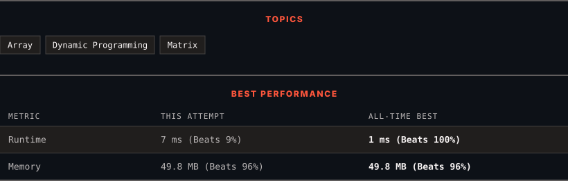

<div align="center">

# 64. Minimum Path Sum

      

[](https://leetcode.com/problems/minimum-path-sum/)

</div>

---

<div align="center">

<picture>
  <source media="(prefers-color-scheme: dark)" srcset="panel-dark.svg">
  <source media="(prefers-color-scheme: light)" srcset="panel-light.svg">
  
</picture>

</div>

> **New personal best** — Runtime improved on this submission.

### HOW IT WENT

| | |
|:--|:--|
| **Attempts** | first try |
| **Time to solve** | 23 min |
| **Verdicts** | ✅ Accepted |

---

### NOTES

_No notes yet._

---

### SOLUTIONS (1)

| # | File | Language | Date |
|:-:|------|:--------:|:----:|
| 1 | [sol1.java](./sol1.java) | `Java` | 2026-10-14 ← **latest** |

---

### PROBLEM DESCRIPTION

Given a `m x n` `grid` filled with non-negative numbers, find a path from top left to bottom right, which minimizes the sum of all numbers along its path.

**Note:** You can only move either down or right at any point in time.

 

**Example 1:**


```

**Input:** grid = [[1,3,1],[1,5,1],[4,2,1]]
**Output:** 7
**Explanation:** Because the path 1 &rarr; 3 &rarr; 1 &rarr; 1 &rarr; 1 minimizes the sum.

```

**Example 2:**

```

**Input:** grid = [[1,2,3],[4,5,6]]
**Output:** 12

```

 

**Constraints:**

	- `m == grid.length`

	- `n == grid[i].length`

	- `1 <= m, n <= 200`

	- `0 <= grid[i][j] <= 200`

---

<div align="center">

<sub>Auto-synced by <strong>LeetSync</strong> · Built by <a href="https://deveshsamant.in/">Devesh Samant</a></sub>

</div>
