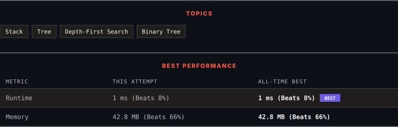

# 94. Binary Tree Inorder Traversal

      

---

<picture>
  <source media="(prefers-color-scheme: dark)" srcset="panel-dark.svg">
  <source media="(prefers-color-scheme: light)" srcset="panel-light.svg">
  
</picture>

> **New personal best** — Runtime improved on this submission.

### HOW IT WENT

| | |
|:--|:--|
| **Attempts** | first try |
| **Time to solve** | 4 min |
| **Verdicts** | ✅ Accepted |

---

### NOTES

_No notes yet._

---

### SOLUTIONS (1)

| # | File | Language | Date |
|:-:|------|:--------:|:----:|
| 1 | [sol1.java](./sol1.java) | `Java` | 2026-11-12 ← **latest** |

---

### PROBLEM DESCRIPTION

Given the `root` of a binary tree, return *the inorder traversal of its nodes' values*.

 

**Example 1:**

**Input:** root = [1,null,2,3]

**Output:** [1,3,2]

**Explanation:**

**Example 2:**

**Input:** root = [1,2,3,4,5,null,8,null,null,6,7,9]

**Output:** [4,2,6,5,7,1,3,9,8]

**Explanation:**

**Example 3:**

**Input:** root = []

**Output:** []

**Example 4:**

**Input:** root = [1]

**Output:** [1]

 

**Constraints:**

	- The number of nodes in the tree is in the range `[0, 100]`.

	- `-100 <= Node.val <= 100`

 

**Follow up:** Recursive solution is trivial, could you do it iteratively?

---

Auto-synced by <strong>LeetSync</strong> · Built by <a href="https://deveshsamant.in/">Devesh Samant</a>

