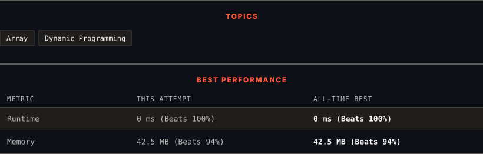

<div align="center">

# 213. House Robber II

      

[](https://leetcode.com/problems/house-robber-ii/)

</div>

---

<div align="center">

<picture>
  <source media="(prefers-color-scheme: dark)" srcset="panel-dark.svg">
  <source media="(prefers-color-scheme: light)" srcset="panel-light.svg">
  
</picture>

</div>

> **New personal best** — Runtime improved on this submission.

### HOW IT WENT

| | |
|:--|:--|
| **Attempts** | first try |
| **Time to solve** | 1 h 19 min |
| **Verdicts** | ✅ Accepted |

---

### NOTES

_No notes yet._

---

### SOLUTIONS (1)

| # | File | Language | Date |
|:-:|------|:--------:|:----:|
| 1 | [sol1.java](./sol1.java) | `Java` | 2026-10-12 ← **latest** |

---

### PROBLEM DESCRIPTION

You are a professional robber planning to rob houses along a street. Each house has a certain amount of money stashed. All houses at this place are **arranged in a circle.** That means the first house is the neighbor of the last one. Meanwhile, adjacent houses have a security system connected, and **it will automatically contact the police if two adjacent houses were broken into on the same night**.

Given an integer array `nums` representing the amount of money of each house, return *the maximum amount of money you can rob tonight **without alerting the police***.

 

**Example 1:**

```

**Input:** nums = [2,3,2]
**Output:** 3
**Explanation:** You cannot rob house 1 (money = 2) and then rob house 3 (money = 2), because they are adjacent houses.

```

**Example 2:**

```

**Input:** nums = [1,2,3,1]
**Output:** 4
**Explanation:** Rob house 1 (money = 1) and then rob house 3 (money = 3).
Total amount you can rob = 1 + 3 = 4.

```

**Example 3:**

```

**Input:** nums = [1,2,3]
**Output:** 3

```

 

**Constraints:**

	- `1 <= nums.length <= 100`

	- `0 <= nums[i] <= 1000`

---

<div align="center">

<sub>Auto-synced by <strong>LeetSync</strong> · Built by <a href="https://deveshsamant.in/">Devesh Samant</a></sub>

</div>
