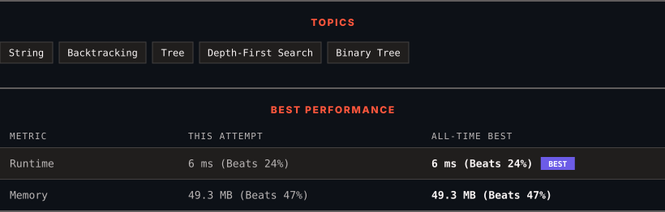

<div align="center">

# 257. Binary Tree Paths

      

[](https://leetcode.com/problems/binary-tree-paths/)

</div>

---

<div align="center">

<picture>
  <source media="(prefers-color-scheme: dark)" srcset="panel-dark.svg">
  <source media="(prefers-color-scheme: light)" srcset="panel-light.svg">
  
</picture>

</div>

> **New personal best** — Runtime improved on this submission.

### HOW IT WENT

| | |
|:--|:--|
| **Attempts** | first try |
| **Time to solve** | under a minute |
| **Verdicts** | ✅ Accepted |

---

### NOTES

_No notes yet._

---

### SOLUTIONS (1)

| # | File | Language | Date |
|:-:|------|:--------:|:----:|
| 1 | [sol1.java](./sol1.java) | `Java` | 2026-11-16 ← **latest** |

---

### PROBLEM DESCRIPTION

You are given the `root` of a binary tree.

Return all **root-to-leaf** paths* *in **any order**.

A **leaf** is a node with no children.

 

**Example 1:**


```

**Input:** root = [1,2,3,null,5]
**Output:** ["1->2->5","1->3"]

```

**Example 2:**

```

**Input:** root = [1]
**Output:** ["1"]

```

 

**Constraints:**

	- The number of nodes in the tree is in the range `[1, 100]`.

	- `-100 <= Node.val <= 100`

---

<div align="center">

<sub>Auto-synced by <strong>LeetSync</strong> · Built by <a href="https://deveshsamant.in/">Devesh Samant</a></sub>

</div>
