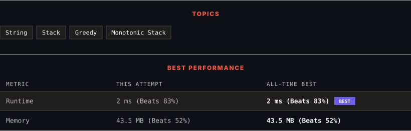

<div align="center">

# 316. Remove Duplicate Letters

      

[](https://leetcode.com/problems/remove-duplicate-letters/)

</div>

---

<div align="center">

<picture>
  <source media="(prefers-color-scheme: dark)" srcset="panel-dark.svg">
  <source media="(prefers-color-scheme: light)" srcset="panel-light.svg">
  
</picture>

</div>

> **New personal best** — Runtime improved on this submission.

### HOW IT WENT

| | |
|:--|:--|
| **Attempts** | first try |
| **Time to solve** | 1 min |
| **Verdicts** | ✅ Accepted |

---

### NOTES

_No notes yet._

---

### SOLUTIONS (1)

| # | File | Language | Date |
|:-:|------|:--------:|:----:|
| 1 | [sol1.java](./sol1.java) | `Java` | 2026-11-17 ← **latest** |

---

### PROBLEM DESCRIPTION

Given a string `s`, remove duplicate letters so that every letter appears once and only once. The relative order of the letters that were not removed must be preserved. You must make sure your result is **the smallest in lexicographical order** among all possible results.

 

**Example 1:**

```

**Input:** s = "bcabc"
**Output:** "abc"

```

**Example 2:**

```

**Input:** s = "cbacdcbc"
**Output:** "acdb"

```

 

**Constraints:**

	- `1 <= s.length <= 10^4`

	- `s` consists of lowercase English letters.

 

**Note:** This question is the same as 1081: [https://leetcode.com/problems/smallest-subsequence-of-distinct-characters/](https://leetcode.com/problems/smallest-subsequence-of-distinct-characters/)

---

<div align="center">

<sub>Auto-synced by <strong>LeetSync</strong> · Built by <a href="https://deveshsamant.in/">Devesh Samant</a></sub>

</div>
