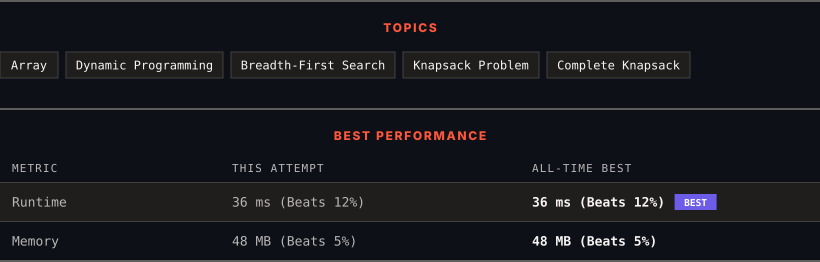

<div align="center">

# 322. Coin Change

      

[](https://leetcode.com/problems/coin-change/)

</div>

---

<div align="center">

<picture>
  <source media="(prefers-color-scheme: dark)" srcset="panel-dark.svg">
  <source media="(prefers-color-scheme: light)" srcset="panel-light.svg">
  
</picture>

</div>

> **New personal best** — Runtime improved on this submission.

### HOW IT WENT

| | |
|:--|:--|
| **Attempts** | 2 before accepted |
| **Time to solve** | 57 min |
| **Verdicts** | ⏱ Time Limit Exceeded → ✅ Accepted |

---

### NOTES

_No notes yet._

---

### SOLUTIONS (1)

| # | File | Language | Date |
|:-:|------|:--------:|:----:|
| 1 | [sol1.java](./sol1.java) | `Java` | 2026-10-28 ← **latest** |

---

### PROBLEM DESCRIPTION

You are given an integer array `coins` representing coins of different denominations and an integer `amount` representing a total amount of money.

Return the **fewest** number of coins that you need to make up that amount. If that amount of money cannot be made up by any combination of the coins, return -1.

You may assume that you have an infinite number of each kind of coin.

 

**Example 1:**

```

**Input:** coins = [1,2,5], amount = 11
**Output:** 3
**Explanation:** 11 = 5 + 5 + 1

```

**Example 2:**

```

**Input:** coins = [2], amount = 3
**Output:** -1

```

**Example 3:**

```

**Input:** coins = [1], amount = 0
**Output:** 0

```

 

**Constraints:**

	- `1 <= coins.length <= 12`

	- `1 <= coins[i] <= 2^31 - 1`

	- `0 <= amount <= 10^4`

---

<div align="center">

<sub>Auto-synced by <strong>LeetSync</strong> · Built by <a href="https://deveshsamant.in/">Devesh Samant</a></sub>

</div>
