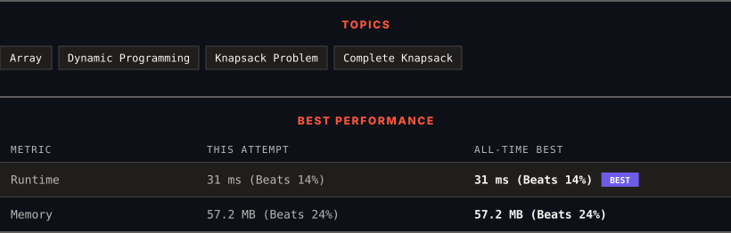

<div align="center">

# 518. Coin Change II

      

[](https://leetcode.com/problems/coin-change-ii/)

</div>

---

<div align="center">

<picture>
  <source media="(prefers-color-scheme: dark)" srcset="panel-dark.svg">
  <source media="(prefers-color-scheme: light)" srcset="panel-light.svg">
  
</picture>

</div>

> **New personal best** — Runtime improved on this submission.

### HOW IT WENT

| | |
|:--|:--|
| **Attempts** | first try |
| **Time to solve** | under a minute |
| **Verdicts** | ✅ Accepted |

---

### NOTES

_No notes yet._

---

### SOLUTIONS (1)

| # | File | Language | Date |
|:-:|------|:--------:|:----:|
| 1 | [sol1.java](./sol1.java) | `Java` | 2026-10-28 ← **latest** |

---

### PROBLEM DESCRIPTION

You are given an integer array `coins` representing coins of different denominations and an integer `amount` representing a total amount of money.

Return *the number of combinations that make up that amount*. If that amount of money cannot be made up by any combination of the coins, return `0`.

You may assume that you have an infinite number of each kind of coin.

The **final** answer is **guaranteed** to fit into a signed **32-bit** integer.

 

**Example 1:**

```

**Input:** amount = 5, coins = [1,2,5]
**Output:** 4
**Explanation:** there are four ways to make up the amount:
5=5
5=2+2+1
5=2+1+1+1
5=1+1+1+1+1

```

**Example 2:**

```

**Input:** amount = 3, coins = [2]
**Output:** 0
**Explanation:** the amount of 3 cannot be made up just with coins of 2.

```

**Example 3:**

```

**Input:** amount = 10, coins = [10]
**Output:** 1

```

 

**Constraints:**

	- `1 <= coins.length <= 300`

	- `1 <= coins[i] <= 5000`

	- All the values of `coins` are **unique**.

	- `0 <= amount <= 5000`

---

<div align="center">

<sub>Auto-synced by <strong>LeetSync</strong> · Built by <a href="https://deveshsamant.in/">Devesh Samant</a></sub>

</div>
