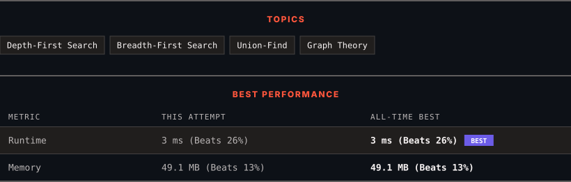

<div align="center">

# 547. Number of Provinces

      

[](https://leetcode.com/problems/number-of-provinces/)

</div>

---

<div align="center">

<picture>
  <source media="(prefers-color-scheme: dark)" srcset="panel-dark.svg">
  <source media="(prefers-color-scheme: light)" srcset="panel-light.svg">
  
</picture>

</div>

> **New personal best** — Runtime improved on this submission.

### HOW IT WENT

| | |
|:--|:--|
| **Attempts** | 2 before accepted |
| **Time to solve** | 13 min |
| **Verdicts** | 🔧 Compile Error → ✅ Accepted |

---

### NOTES

_No notes yet._

---

### SOLUTIONS (1)

| # | File | Language | Date |
|:-:|------|:--------:|:----:|
| 1 | [sol1.java](./sol1.java) | `Java` | 2026-11-27 ← **latest** |

---

### PROBLEM DESCRIPTION

There are `n` cities. Some of them are connected, while some are not. If city `a` is connected directly with city `b`, and city `b` is connected directly with city `c`, then city `a` is connected indirectly with city `c`.

A **province** is a group of directly or indirectly connected cities and no other cities outside of the group.

You are given an `n x n` matrix `isConnected` where `isConnected[i][j] = 1` if the `i^th` city and the `j^th` city are directly connected, and `isConnected[i][j] = 0` otherwise.

Return *the total number of **provinces***.

 

**Example 1:**


```

**Input:** isConnected = [[1,1,0],[1,1,0],[0,0,1]]
**Output:** 2

```

**Example 2:**


```

**Input:** isConnected = [[1,0,0],[0,1,0],[0,0,1]]
**Output:** 3

```

 

**Constraints:**

	- `1 <= n <= 200`

	- `n == isConnected.length`

	- `n == isConnected[i].length`

	- `isConnected[i][j]` is `1` or `0`.

	- `isConnected[i][i] == 1`

	- `isConnected[i][j] == isConnected[j][i]`

---

<div align="center">

<sub>Auto-synced by <strong>LeetSync</strong> · Built by <a href="https://deveshsamant.in/">Devesh Samant</a></sub>

</div>
