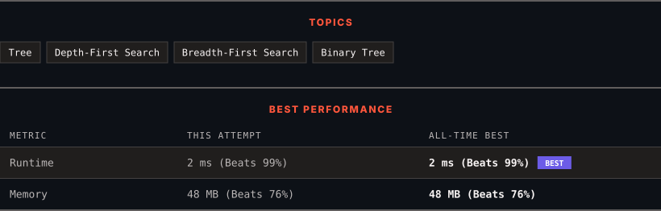

<div align="center">

# 637. Average of Levels in Binary Tree

      

[](https://leetcode.com/problems/average-of-levels-in-binary-tree/)

</div>

---

<div align="center">

<picture>
  <source media="(prefers-color-scheme: dark)" srcset="panel-dark.svg">
  <source media="(prefers-color-scheme: light)" srcset="panel-light.svg">
  
</picture>

</div>

> **New personal best** — Runtime improved on this submission.

### HOW IT WENT

| | |
|:--|:--|
| **Attempts** | first try |
| **Time to solve** | 1 min |
| **Verdicts** | ✅ Accepted |

---

### NOTES

_No notes yet._

---

### SOLUTIONS (1)

| # | File | Language | Date |
|:-:|------|:--------:|:----:|
| 1 | [sol1.java](./sol1.java) | `Java` | 2026-11-27 ← **latest** |

---

### PROBLEM DESCRIPTION

Given the `root` of a binary tree, return *the average value of the nodes on each level in the form of an array*. Answers within `10^-5` of the actual answer will be accepted.
 

**Example 1:**


```

**Input:** root = [3,9,20,null,null,15,7]
**Output:** [3.00000,14.50000,11.00000]
Explanation: The average value of nodes on level 0 is 3, on level 1 is 14.5, and on level 2 is 11.
Hence return [3, 14.5, 11].

```

**Example 2:**


```

**Input:** root = [3,9,20,15,7]
**Output:** [3.00000,14.50000,11.00000]

```

 

**Constraints:**

	- The number of nodes in the tree is in the range `[1, 10^4]`.

	- `-2^31 <= Node.val <= 2^31 - 1`

---

<div align="center">

<sub>Auto-synced by <strong>LeetSync</strong> · Built by <a href="https://deveshsamant.in/">Devesh Samant</a></sub>

</div>
