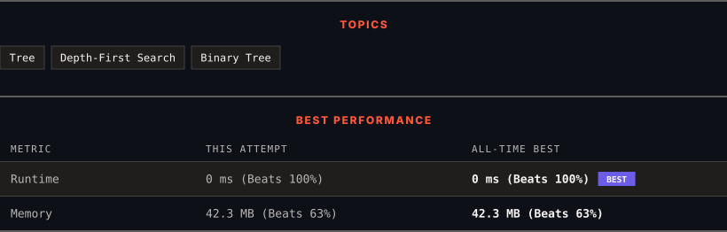

<div align="center">

# 671. Second Minimum Node In a Binary Tree

      

[](https://leetcode.com/problems/second-minimum-node-in-a-binary-tree/)

</div>

---

<div align="center">

<picture>
  <source media="(prefers-color-scheme: dark)" srcset="panel-dark.svg">
  <source media="(prefers-color-scheme: light)" srcset="panel-light.svg">
  
</picture>

</div>

> **New personal best** — Runtime improved on this submission.

### HOW IT WENT

| | |
|:--|:--|
| **Attempts** | first try |
| **Time to solve** | 1 min |
| **Verdicts** | ✅ Accepted |

---

### NOTES

_No notes yet._

---

### SOLUTIONS (1)

| # | File | Language | Date |
|:-:|------|:--------:|:----:|
| 1 | [sol1.java](./sol1.java) | `Java` | 2026-11-27 ← **latest** |

---

### PROBLEM DESCRIPTION

Given a non-empty special binary tree consisting of nodes with the non-negative value, where each node in this tree has exactly `two` or `zero` sub-node. If the node has two sub-nodes, then this node's value is the smaller value among its two sub-nodes. More formally, the property `root.val = min(root.left.val, root.right.val)` always holds.

Given such a binary tree, you need to output the **second minimum** value in the set made of all the nodes' value in the whole tree.

If no such second minimum value exists, output -1 instead.

 

 

**Example 1:**


```

**Input:** root = [2,2,5,null,null,5,7]
**Output:** 5
**Explanation:** The smallest value is 2, the second smallest value is 5.

```

**Example 2:**


```

**Input:** root = [2,2,2]
**Output:** -1
**Explanation:** The smallest value is 2, but there isn't any second smallest value.

```

 

**Constraints:**

	- The number of nodes in the tree is in the range `[1, 25]`.

	- `1 <= Node.val <= 2^31 - 1`

	- `root.val == min(root.left.val, root.right.val)` for each internal node of the tree.

---

<div align="center">

<sub>Auto-synced by <strong>LeetSync</strong> · Built by <a href="https://deveshsamant.in/">Devesh Samant</a></sub>

</div>
