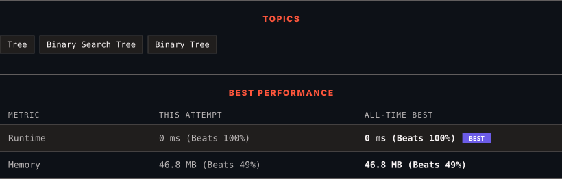

<div align="center">

# 701. Insert into a Binary Search Tree

      

[](https://leetcode.com/problems/insert-into-a-binary-search-tree/)

</div>

---

<div align="center">

<picture>
  <source media="(prefers-color-scheme: dark)" srcset="panel-dark.svg">
  <source media="(prefers-color-scheme: light)" srcset="panel-light.svg">
  
</picture>

</div>

> **New personal best** — Runtime improved on this submission.

### HOW IT WENT

| | |
|:--|:--|
| **Attempts** | first try |
| **Time to solve** | under a minute |
| **Verdicts** | ✅ Accepted |

---

### NOTES

_No notes yet._

---

### SOLUTIONS (1)

| # | File | Language | Date |
|:-:|------|:--------:|:----:|
| 1 | [sol1.java](./sol1.java) | `Java` | 2026-11-19 ← **latest** |

---

### PROBLEM DESCRIPTION

You are given the `root` node of a binary search tree (BST) and a `value` to insert into the tree. Return *the root node of the BST after the insertion*. It is **guaranteed** that the new value does not exist in the original BST.

**Notice** that there may exist multiple valid ways for the insertion, as long as the tree remains a BST after insertion. You can return **any of them**.

 

**Example 1:**


```

**Input:** root = [4,2,7,1,3], val = 5
**Output:** [4,2,7,1,3,5]
**Explanation:** Another accepted tree is:


```

**Example 2:**

```

**Input:** root = [40,20,60,10,30,50,70], val = 25
**Output:** [40,20,60,10,30,50,70,null,null,25]

```

**Example 3:**

```

**Input:** root = [4,2,7,1,3,null,null,null,null,null,null], val = 5
**Output:** [4,2,7,1,3,5]

```

 

**Constraints:**

	- The number of nodes in the tree will be in the range `[0, 10^4]`.

	- `-10^8 <= Node.val <= 10^8`

	- All the values `Node.val` are **unique**.

	- `-10^8 <= val <= 10^8`

	- It's **guaranteed** that `val` does not exist in the original BST.

---

<div align="center">

<sub>Auto-synced by <strong>LeetSync</strong> · Built by <a href="https://deveshsamant.in/">Devesh Samant</a></sub>

</div>
