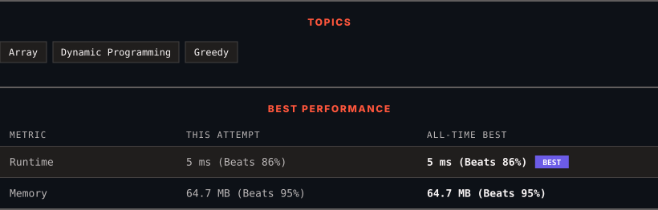

<div align="center">

# 714. Best Time to Buy and Sell Stock with Transaction Fee

      

[](https://leetcode.com/problems/best-time-to-buy-and-sell-stock-with-transaction-fee/)

</div>

---

<div align="center">

<picture>
  <source media="(prefers-color-scheme: dark)" srcset="panel-dark.svg">
  <source media="(prefers-color-scheme: light)" srcset="panel-light.svg">
  
</picture>

</div>

> **New personal best** — Runtime improved on this submission.

### HOW IT WENT

| | |
|:--|:--|
| **Attempts** | first try |
| **Time to solve** | 2 min |
| **Verdicts** | ✅ Accepted |

---

### NOTES

_No notes yet._

---

### SOLUTIONS (1)

| # | File | Language | Date |
|:-:|------|:--------:|:----:|
| 1 | [sol1.java](./sol1.java) | `Java` | 2026-11-17 ← **latest** |

---

### PROBLEM DESCRIPTION

You are given an array `prices` where `prices[i]` is the price of a given stock on the `i^th` day, and an integer `fee` representing a transaction fee.

Find the maximum profit you can achieve. You may complete as many transactions as you like, but you need to pay the transaction fee for each transaction.

**Note:**

	- You may not engage in multiple transactions simultaneously (i.e., you must sell the stock before you buy again).

	- The transaction fee is only charged once for each stock purchase and sale.

 

**Example 1:**

```

**Input:** prices = [1,3,2,8,4,9], fee = 2
**Output:** 8
**Explanation:** The maximum profit can be achieved by:
- Buying at prices[0] = 1
- Selling at prices[3] = 8
- Buying at prices[4] = 4
- Selling at prices[5] = 9
The total profit is ((8 - 1) - 2) + ((9 - 4) - 2) = 8.

```

**Example 2:**

```

**Input:** prices = [1,3,7,5,10,3], fee = 3
**Output:** 6

```

 

**Constraints:**

	- `1 <= prices.length <= 5 * 10^4`

	- `1 <= prices[i] < 5 * 10^4`

	- `0 <= fee < 5 * 10^4`

---

<div align="center">

<sub>Auto-synced by <strong>LeetSync</strong> · Built by <a href="https://deveshsamant.in/">Devesh Samant</a></sub>

</div>
