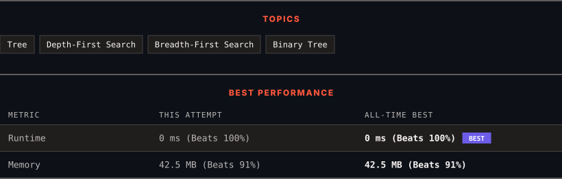

<div align="center">

# 993. Cousins in Binary Tree

      

[](https://leetcode.com/problems/cousins-in-binary-tree/)

</div>

---

<div align="center">

<picture>
  <source media="(prefers-color-scheme: dark)" srcset="panel-dark.svg">
  <source media="(prefers-color-scheme: light)" srcset="panel-light.svg">
  
</picture>

</div>

> **New personal best** — Runtime improved on this submission.

### HOW IT WENT

| | |
|:--|:--|
| **Attempts** | first try |
| **Time to solve** | 2 min |
| **Verdicts** | ✅ Accepted |

---

### NOTES

_No notes yet._

---

### SOLUTIONS (1)

| # | File | Language | Date |
|:-:|------|:--------:|:----:|
| 1 | [sol1.java](./sol1.java) | `Java` | 2026-11-27 ← **latest** |

---

### PROBLEM DESCRIPTION

Given the `root` of a binary tree with unique values and the values of two different nodes of the tree `x` and `y`, return `true` *if the nodes corresponding to the values *`x`* and *`y`* in the tree are **cousins**, or *`false`* otherwise.*

Two nodes of a binary tree are **cousins** if they have the same depth with different parents.

Note that in a binary tree, the root node is at the depth `0`, and children of each depth `k` node are at the depth `k + 1`.

 

**Example 1:**


```

**Input:** root = [1,2,3,4], x = 4, y = 3
**Output:** false

```

**Example 2:**


```

**Input:** root = [1,2,3,null,4,null,5], x = 5, y = 4
**Output:** true

```

**Example 3:**


```

**Input:** root = [1,2,3,null,4], x = 2, y = 3
**Output:** false

```

 

**Constraints:**

	- The number of nodes in the tree is in the range `[2, 100]`.

	- `1 <= Node.val <= 100`

	- Each node has a **unique** value.

	- `x != y`

	- `x` and `y` are exist in the tree.

---

<div align="center">

<sub>Auto-synced by <strong>LeetSync</strong> · Built by <a href="https://deveshsamant.in/">Devesh Samant</a></sub>

</div>
