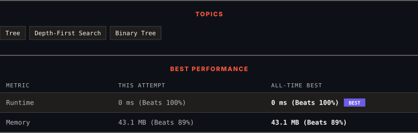

<div align="center">

# 1022. Sum of Root To Leaf Binary Numbers

      

[](https://leetcode.com/problems/sum-of-root-to-leaf-binary-numbers/)

</div>

---

<div align="center">

<picture>
  <source media="(prefers-color-scheme: dark)" srcset="panel-dark.svg">
  <source media="(prefers-color-scheme: light)" srcset="panel-light.svg">
  
</picture>

</div>

> **New personal best** — Runtime improved on this submission.

### HOW IT WENT

| | |
|:--|:--|
| **Attempts** | first try |
| **Time to solve** | 4 min |
| **Verdicts** | ✅ Accepted |

---

### NOTES

_No notes yet._

---

### SOLUTIONS (1)

| # | File | Language | Date |
|:-:|------|:--------:|:----:|
| 1 | [sol1.java](./sol1.java) | `Java` | 2026-11-27 ← **latest** |

---

### PROBLEM DESCRIPTION

You are given the `root` of a binary tree where each node has a value `0` or `1`. Each root-to-leaf path represents a binary number starting with the most significant bit.

	- For example, if the path is `0 -> 1 -> 1 -> 0 -> 1`, then this could represent `01101` in binary, which is `13`.

For all leaves in the tree, consider the numbers represented by the path from the root to that leaf. Return *the sum of these numbers*.

The test cases are generated so that the answer fits in a **32-bits** integer.

 

**Example 1:**


```

**Input:** root = [1,0,1,0,1,0,1]
**Output:** 22
**Explanation: **(100) + (101) + (110) + (111) = 4 + 5 + 6 + 7 = 22

```

**Example 2:**

```

**Input:** root = [0]
**Output:** 0

```

 

**Constraints:**

	- The number of nodes in the tree is in the range `[1, 1000]`.

	- `Node.val` is `0` or `1`.

---

<div align="center">

<sub>Auto-synced by <strong>LeetSync</strong> · Built by <a href="https://deveshsamant.in/">Devesh Samant</a></sub>

</div>
