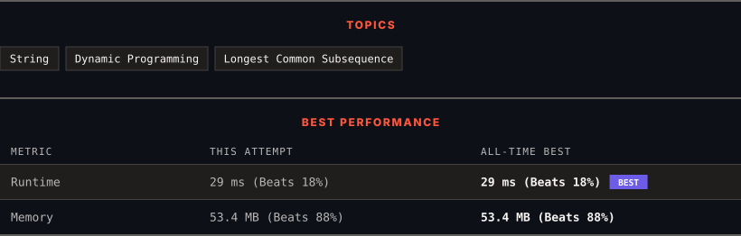

<div align="center">

# 1143. Longest Common Subsequence

      

[](https://leetcode.com/problems/longest-common-subsequence/)

</div>

---

<div align="center">

<picture>
  <source media="(prefers-color-scheme: dark)" srcset="panel-dark.svg">
  <source media="(prefers-color-scheme: light)" srcset="panel-light.svg">
  
</picture>

</div>

> **New personal best** — Runtime improved on this submission.

### HOW IT WENT

| | |
|:--|:--|
| **Attempts** | first try |
| **Time to solve** | 40 min |
| **Verdicts** | ✅ Accepted |

---

### NOTES

_No notes yet._

---

### SOLUTIONS (1)

| # | File | Language | Date |
|:-:|------|:--------:|:----:|
| 1 | [sol1.java](./sol1.java) | `Java` | 2026-10-26 ← **latest** |

---

### PROBLEM DESCRIPTION

Given two strings `text1` and `text2`, return *the length of their longest **common subsequence**. *If there is no **common subsequence**, return `0`.

A **subsequence** of a string is a new string generated from the original string with some characters (can be none) deleted without changing the relative order of the remaining characters.

	- For example, `"ace"` is a subsequence of `"abcde"`.

A **common subsequence** of two strings is a subsequence that is common to both strings.

 

**Example 1:**

```

**Input:** text1 = "abcde", text2 = "ace" 
**Output:** 3  
**Explanation:** The longest common subsequence is "ace" and its length is 3.

```

**Example 2:**

```

**Input:** text1 = "abc", text2 = "abc"
**Output:** 3
**Explanation:** The longest common subsequence is "abc" and its length is 3.

```

**Example 3:**

```

**Input:** text1 = "abc", text2 = "def"
**Output:** 0
**Explanation:** There is no such common subsequence, so the result is 0.

```

 

**Constraints:**

	- `1 <= text1.length, text2.length <= 1000`

	- `text1` and `text2` consist of only lowercase English characters.

---

<div align="center">

<sub>Auto-synced by <strong>LeetSync</strong> · Built by <a href="https://deveshsamant.in/">Devesh Samant</a></sub>

</div>
